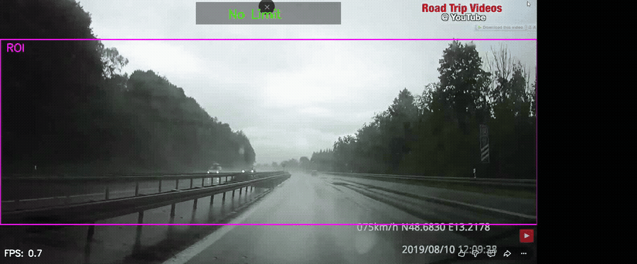

# Traffic Sign Recognition and EU Regulations on Intelligent Speed Assistance


This repository contains the implementation of a real-time, two-stage Traffic Sign Recognition (TSR) pipeline, together with an analysis of how it aligns with the European Union requirements for Intelligent Speed Assistance (ISA).

The project evaluates a YOLO26m-based pipeline under adverse environmental conditions (rain, glare, night and fog) and documents its failure modes with respect to EU ISA requirements.

- **Type:** Seminar project, Technische Hochschule Ingolstadt (THI)
- **Timeframe:** 03/2026 — 07/2026
- **Grade:** 1.0
- **Stack:** Python, YOLO, OpenCV, CUDA

---

## Technical Architecture Overview

The perception system is divided into two sequential YOLO stages:

1. Stage 1: Localisation (GTSDB): A first YOLO detector, trained on GTSDB, processes full driving-scene frames (1280 x 1280 pixels during training) and localises traffic signs as regions of interest (RoIs).
2. Stage 2: Sign type (GTSRB): A second YOLO detector, trained on GTSRB, runs on the cropped RoIs (640 x 640 pixels during training) and identifies the sign type across 43 classes.

---

## Experimental Results

The models were trained and evaluated on Google Colab Pro with an NVIDIA A100-SXM4-40GB GPU. The metrics below come from the best validation checkpoints:

| Pipeline Stage / Dataset | Precision (P) | Recall (R) | mAP50 |
| :--- | :---: | :---: | :---: |
| Stage 1: Localisation (GTSDB) | 0.888 | 0.914 | 0.970 |
| Stage 2: Sign type, 43 classes (GTSRB) | 0.942 | 0.921 | 0.950 |

Inference time: **5.7 ms** on an NVIDIA A100.

---

## Robustness and EU ISA Analysis

* **Stress tests:** The pipeline was stress-tested under rain, glare, night and fog. Documented failure modes include false positives and cross-lane attribution (a sign meant for another lane being applied to the ego lane).
* **EU ISA alignment:** Analysed how the pipeline aligns with EU ISA requirements.
* **Proposed mitigations:** temporal multi-frame verification, centre-ROI filtering, and V2X-based mitigation for occluded signs.

---

## Demo Script Features (`modeltest.py`)

* NMS-Free Prediction Head: Uses the end-to-end detection head of YOLO26, which removes the Non-Maximum Suppression (NMS) step.
* Basic temporal confirmation: A sign must be detected in at least 2 consecutive frames (IoU-matched, same class) before the HUD is updated — a simple first version of the proposed temporal multi-frame verification.
* Fixed ROI band: Detections are only accepted inside a fixed vertical band of the frame, plus a sign-size filter — a simple first version of the proposed ROI filtering.
* Interactive Telemetry HUD: Displays the current speed limit alongside a side panel showing recent detections and their detection counts.

---

## Core Dependencies

To replicate the execution environment, ensure the following core libraries are installed:

* Python >= 3.8
* PyTorch >= 2.0
* Ultralytics (configured for YOLO26 architectures)
* OpenCV-Python
* NumPy

Install all packages via:
```
pip install -r requirements.txt
```

---

## Academic Context

This study was conducted as part of the seminar Grundlagen der Fahrerassistenz- und der aktiven Sicherheitssysteme at Technische Hochschule Ingolstadt (THI) during the Summer Semester 2026 (grade: 1.0).

* Author: Mohammadali Avazpour
* Academic Supervisor: Professor Alexander Knorr
* Institution: Faculty of Electrical Engineering and Information Technology, Technische Hochschule Ingolstadt (THI)
